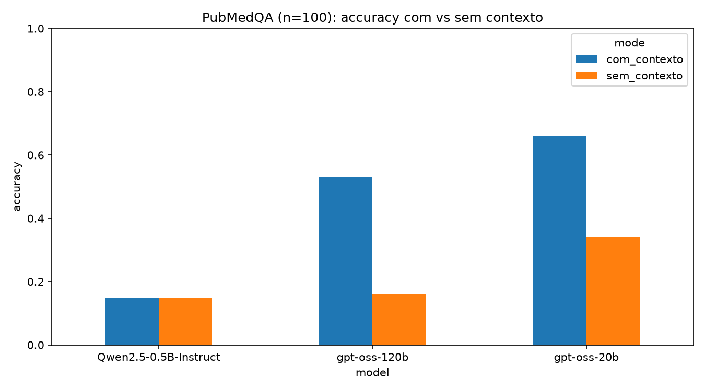

# LLM Bench Oncology

**How well do open LLMs answer biomedical research questions, and how much does giving them the source abstract help?**

A small, reproducible benchmark on [PubMedQA](https://huggingface.co/datasets/qiaojin/PubMedQA) (`pqa_labeled`, 100 random questions, seed 42). Each question is asked in two modes:

- **No context:** the model only sees the question.
- **With context:** the model also sees the abstract of the paper. This is a minimal form of retrieval-augmented generation (RAG) with perfect retrieval.

The answer must be a single word: `yes`, `no` or `maybe`.

## Models

| Model | Size | Access | Notes |
|---|---|---|---|
| `openai/gpt-oss-20b` | 20B | API (Groq, OpenAI-compatible) | Reasoning model, `reasoning_effort="low"` |
| `openai/gpt-oss-120b` | 120B | API (Groq, OpenAI-compatible) | Reasoning model, `reasoning_effort="low"` |
| `Qwen/Qwen2.5-0.5B-Instruct` | 0.5B | Local, Hugging Face `transformers` on CPU | Small instruct model |

## Results (n = 100)

| Model | Mode | Accuracy | Mean latency (s) |
|---|---|---|---|
| gpt-oss-20b | no context | 0.34 | 0.42 |
| gpt-oss-20b | **with context** | **0.66** | 0.39 |
| gpt-oss-120b | no context | 0.16 | 0.38 |
| gpt-oss-120b | with context | 0.53 | 0.41 |
| Qwen2.5-0.5B | no context | 0.15 | 1.80 |
| Qwen2.5-0.5B | with context | 0.15 | 8.41 |

Label distribution in the sample: yes 45 · no 40 · maybe 15. A trivial "always yes" baseline gets **0.45**.



### What the models actually answered

| Model | Mode | maybe | no | yes |
|---|---|---|---|---|
| gpt-oss-20b | no context | 52 | 11 | 37 |
| gpt-oss-20b | with context | 28 | 29 | 43 |
| gpt-oss-120b | no context | **83** | 2 | 15 |
| gpt-oss-120b | with context | 46 | 18 | 36 |
| Qwen2.5-0.5B | both | **100** | 0 | 0 |

## Findings

1. **Context is the single biggest lever.** Giving the abstract roughly doubles accuracy for gpt-oss-20b (0.34 → 0.66) and more than triples it for gpt-oss-120b (0.16 → 0.53). This is the core argument for retrieval-augmented systems in biomedicine.
2. **Bigger was not better here, because the larger model hedges more.** Without context, gpt-oss-120b answered `maybe` 83% of the time, while only 15% of the gold labels are `maybe`. With context it hedges less, but still more than the 20B model. Its low accuracy reflects calibration and answer policy more than missing knowledge.
3. **Only one configuration clearly beats the trivial baseline.** gpt-oss-20b with context (0.66) is the only setup well above "always yes" (0.45). This shows why raw accuracy must always be read against a baseline.
4. **The 0.5B model collapses to a single class.** Qwen2.5-0.5B answered `maybe` to every question, so its 0.15 is exactly the share of `maybe` labels. Small local models are cheap and private, but on CPU they are about 20× slower with context and not usable for this task.
5. **Output format is part of the problem.** Earlier runs with a strict 5-token limit produced empty or truncated answers, and reasoning models need a larger token budget. A system prompt, a sufficient `max_tokens` and a robust parser were required for 0 invalid answers.

## Limitations

- n = 100, so the 95% interval on each accuracy is roughly ±10 points. The 20B-vs-120B gap with context is suggestive, not conclusive.
- A single prompt was used, and results are sensitive to prompt wording and `reasoning_effort`.
- The "with context" mode uses the gold abstract, which means perfect retrieval. A real RAG system first has to find the right document; that is the next project.
- Accuracy alone hides class imbalance. Macro-F1 and a confusion matrix would be better metrics.

## How to run

```bash
python -m venv .venv
.venv\Scripts\activate          # Windows  (macOS/Linux: source .venv/bin/activate)
pip install -r requirements.txt
echo GROQ_API_KEY=your_key > .env
python benchmark.py             # set N at the top of the file
```

Outputs: `results.csv` (every answer), `summary.csv` (metrics), `accuracy.png` (chart).

## Stack

Hugging Face `datasets` and `transformers` · OpenAI-compatible client (Groq) · pandas · matplotlib

## Next

This benchmark assumes the right abstract is already known. **[OncoRAG](#)** tackles the missing step: retrieving and re-ranking the right papers from a corpus before answering.
